  

  

  

<<<<<<< HEAD

  

  

=======
## About Me
>>>>>>> 16f39b0a103242b18f4de7abb4e637622160cf43

  

<<<<<<< HEAD
<!-- Add verified project links here, e.g. [Movie Discovery source](https://github.com/Mahendra-dev-hub/<repo>) -->

  

=======
## Education
>>>>>>> 16f39b0a103242b18f4de7abb4e637622160cf43

  

<<<<<<< HEAD

  

  

  <a href="https://github.com/Mahendra-dev-hub">github.com/Mahendra-dev-hub</a>

<!-- Add your verified LinkedIn URL here -->
=======
## Technical Skills

| Category | Technologies |
|---|---|
| Languages | Python, SQL |
| Backend | FastAPI, REST APIs |
| Frontend | React |
| Database / ORM | SQLAlchemy, SQLite (where used in project) |
| Data and image libraries | NumPy, Pandas, OpenCV |
| Security tools | Nmap, Burp Suite, Wireshark, Nessus |
| Tools | Git, GitHub |

## Featured Projects

<table>
  <tr>
    <td width="33%" valign="top">
      <h3>🎬 Movie Discovery and Watchlist</h3>
      
A full-stack application for discovering movies and managing a personal watchlist.

      
<strong>Stack:</strong> Python, FastAPI, React, SQLAlchemy, TMDB API

      
<strong>Features:</strong> Discovery and filtering, TMDB movie information, watchlist management.

      
Source code: <em>add your verified repository URL</em> Live demo: <em>add your verified URL, if available</em>

    </td>
    <td width="33%" valign="top">
      <h3>📄 Resume Tailoring Application</h3>
      
An application that helps tailor resume content to a job description.

      
<strong>Stack:</strong> Python, FastAPI, AI API integration <em>(verify exact provider in your source code)</em>

      
Source code: <em>add your verified repository URL</em> Live demo: <em>add your verified URL, if available</em>

    </td>
    <td width="33%" valign="top">
      <h3>🌦️ Weather Application</h3>
      
A weather application that retrieves location and forecast information using a weather API.

      
<strong>Stack:</strong> Python, FastAPI, Open-Meteo API

      
Source code: <em>add your verified repository URL</em> Live demo: <em>add your verified URL, if available</em>

    </td>
  </tr>
</table>

## Experience

**Technical Support Network L2 Intern — ConnectSecure**  
Worked with a product used to scan systems and identify vulnerabilities across Windows, Linux, and macOS environments; Nessus was among the tools used.

**VAPT Intern — Cartel Software Pvt. Ltd.**  
May 2023 – October 2023

## Certifications

- Certified Ethical Hacker (CEH) — include only if your certification is current and verifiable.
- Python certification — add the issuing organization and credential details if available.

## GitHub Contribution Heatmap

Live data pulled from my GitHub account.

  

## Connect

- GitHub: https://github.com/Mahendra-dev-hub
- LinkedIn: add your verified LinkedIn profile URL

---
>>>>>>> 16f39b0a103242b18f4de7abb4e637622160cf43

  

