<!-- =============== SINGLE ANIMATED PROFILE =============== -->

  

<!-- =============== CLICKABLE PROJECT LINKS =============== -->

  
  &nbsp;
  

<!-- =============== CONTRIBUTION GRAPH =============== -->

  

<!-- =============== ANIMATED FOOTER =============== -->

  

<!-- =============== SOCIAL LINKS =============== -->

  
  
  

