  <picture>
    <source media="(prefers-color-scheme: dark)" srcset="./dark.svg">
    <source media="(prefers-color-scheme: light)" srcset="./light.svg">
    
  </picture>

### Python Developer · Backend Developer · Cybersecurity Enthusiast

## About

I’m **Mahendra Bandaru**, a Python developer with a focus on backend development and cybersecurity. I enjoy building practical applications, designing APIs, and bringing a security-minded approach to software.

---

## Technical skills

| Focus | Tools & technologies |
|---|---|
| **Languages** | Python · SQL |
| **Backend** | FastAPI · REST APIs · SQLAlchemy |
| **Frontend** | React |
| **Data & computer vision** | NumPy · Pandas · OpenCV |
| **Security** | Nmap · Burp Suite · Wireshark · Nessus |
| **Developer tools** | Git · GitHub |

## Featured projects

### Weather Application

A full-stack weather app with a React/Vite interface and a FastAPI service for city-based current-weather lookups.

- **Technologies:** Python · FastAPI · Requests · React · Vite · WeatherAPI
- **Project:** [Source repository](https://github.com/Mahendra-dev-hub/live-weather-app) · [Live demo](https://live-weather-app-xi.vercel.app)

### Other projects

Movie Discovery and Watchlist Application · Resume Tailoring Application 
These projects are listed in my profile materials; source files and verified public links were not available, so I’m not adding technical details or URLs yet.

## Experience

- **Technical Support, Network L2 Intern** — ConnectSecure
- **VAPT Intern** — Cartel Software Pvt. Ltd. · May 2023 – October 2023

## Education

**B.Tech in Computer Science and Engineering** 
St. Mark Educational Institution Society Group of Institutions · Affiliated with JNTU Anantapur 
Graduated 2023 · **CGPA: 6.67**

## GitHub contributions

This contribution animation is generated from GitHub contribution activity by the repository’s existing workflow. It shows activity visually without estimated counts, streaks, or rankings.

  <picture>
    <source media="(prefers-color-scheme: dark)" srcset="https://raw.githubusercontent.com/Mahendra-dev-hub/Mahendra/output/github-contribution-grid-snake-dark.svg">
    <source media="(prefers-color-scheme: light)" srcset="https://raw.githubusercontent.com/Mahendra-dev-hub/Mahendra/output/github-contribution-grid-snake.svg">
    
  </picture>

## Certifications & achievements

CEH and Python certifications were mentioned, but supporting records were not available to verify the issuing organizations or credentials. They are omitted until documentation is available. No achievements are listed without supporting evidence.

## Professional links

- [GitHub](https://github.com/Mahendra-dev-hub)
- [LinkedIn](https://www.linkedin.com/in/mahendra-bhandaru)
- [LeetCode](https://leetcode.com/u/mahe5757/)

---

Thanks for stopping by · Mahendra Bandaru

