  <picture>
    <source media="(prefers-color-scheme: dark)" srcset="dark.svg">
    <source media="(prefers-color-scheme: light)" srcset="light.svg">
    
  </picture>

<h1 align="center">Mahendra Bandaru</h1>

  <strong>Python Developer · Backend Development · Cybersecurity</strong>

  Building practical applications, API-driven services, and security-minded software.

---

## About Me

I'm a Python developer interested in dependable backend services, API development, web applications, and cybersecurity. I enjoy turning practical problems into working software and continuously improving my development skills.

## Education

**B.Tech in Computer Science and Engineering**  
St. Mark Educational Institution Society Group of Institutions · Affiliated with JNTU Anantapur  
Graduated in 2023 · **CGPA: 6.67**

## Technical Skills

| Category | Technologies |
|---|---|
| Languages | Python, SQL |
| Backend | FastAPI, REST APIs |
| Frontend | React |
| Database / ORM | SQLAlchemy, SQLite (where used in project) |
| Data and image libraries | NumPy, Pandas, OpenCV |
| Security tools | Nmap, Burp Suite, Wireshark, Nessus |
| Tools | Git, GitHub |

## Featured Projects

### Movie Discovery and Watchlist Application

A full-stack application for discovering movies and managing a personal watchlist.

**Technologies:** Python, FastAPI, React, SQLAlchemy, TMDB API  
**Features:** Movie discovery and filtering, movie information from TMDB, and watchlist management.

- Source code: Add your verified repository URL here.
- Live demo: Add your verified Vercel/Render URL here, if available.

### Resume Tailoring Application

An application that helps tailor resume content to a job description.

**Technologies:** Python, FastAPI, AI API integration (verify exact provider and implementation in your source code).

- Source code: Add your verified repository URL here.
- Live demo: Add your verified demo URL here, if available.

### Weather Application

A weather application that retrieves location and forecast information using a weather API.

**Technologies:** Python, FastAPI, Open-Meteo API.

- Source code: Add your verified repository URL here.
- Live demo: Add your verified demo URL here, if available.

## Experience

**Technical Support Network L2 Intern — ConnectSecure**  
Worked with a product used to scan systems and identify vulnerabilities across Windows, Linux, and macOS environments; Nessus was among the tools used.

**VAPT Intern — Cartel Software Pvt. Ltd.**  
May 2023 – October 2023

## Certifications

- Certified Ethical Hacker (CEH) — include only if your certification is current and verifiable.
- Python certification — add the issuing organization and credential details if available.

## GitHub Activity

GitHub displays your contribution activity on your profile automatically. I avoid displaying unverified contribution counts or statistics here.

## Connect

- GitHub: https://github.com/Mahendra-dev-hub
- LinkedIn: Add your verified LinkedIn profile URL.

---

  Build with intent · Learn continuously · Keep shipping

